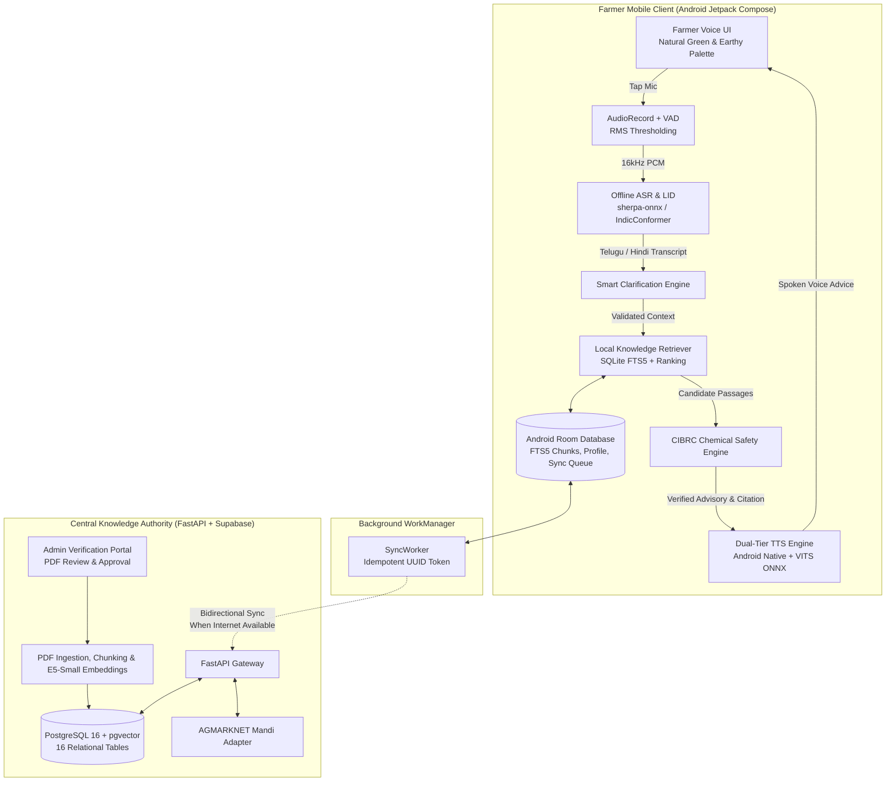

# Bol Kisan Architecture & System Design
**PS-16: Trustworthy Offline Voice Advisory for Farmers**
*Team Straw Hats | INNOVASIA 2K26*

---

## 1. Architectural Philosophy: Offline-First & Zero-Trust Grounding

Rural Indian agriculture presents three severe constraints:
1. **Connectivity**: Erratic 2G/4G or complete lack of network connectivity in fields.
2. **Device Hardware**: Budget smartphones (2GB to 4GB RAM) that crash under heavy local LLMs.
3. **High Stakes**: Fabricated chemical dosages or misdiagnosed crop diseases can cause severe financial ruin or crop loss.

Bol Kisan solves this with a **Dual-Plane Architecture**:
- **On-Device Edge Plane**: 100% autonomous, zero-hallucination voice pipeline operating on Android Room with SQLite FTS5 lexical retrieval and native ONNX speech models.
- **Central Cloud Plane**: Administrative portal for PDF verification, chunking, pgvector semantic indexing, and knowledge-pack distribution.



---

## 2. Complete End-to-End Voice Pipeline

The user interaction follows a strict 12-step sequence:

```
1. Farmer speaks into microphone
   ↓
2. Audio recording (AudioRecord 16kHz Mono PCM)
   ↓
3. Voice activity detection (RMS energy thresholding filters silence/noise)
   ↓
4. Speech recognition (sherpa-onnx IndicConformer acoustic decode)
   ↓
5. Spoken language identification (Auto-detects Telugu or Hindi)
   ↓
6. Question transcription & display (Farmer visually confirms input)
   ↓
7. Question analysis (Checks for symptoms, crops, chemical triggers)
   ↓
8. Local knowledge retrieval (SQLite FTS5 query on approved knowledge packs)
   ↓
9. Evidence validation (Thresholding: minimum 2 substantive matches required)
   ↓
10. Safety validation (CIBRC pesticide label validation & banned chemical block)
    ↓
11. Grounded answer generation (Exact document title & page citation attached)
    ↓
12. Text-to-speech synthesis (Native Indic TTS speaks answer in Telugu / Hindi)
```

---

## 3. Grounded RAG Decision Scenarios

Bol Kisan strictly enforces three mutually exclusive answer pathways:

```
                     ┌───────────────────────────┐
                     │ Farmer's Speech Input     │
                     └─────────────┬─────────────┘
                                   │
                                   ▼
                     ┌───────────────────────────┐
                     │ Chemical Query Trigger?   │
                     └──────┬─────────────┬──────┘
                       Yes  │             │ No
                            ▼             ▼
             ┌─────────────────────┐   ┌───────────────────────────┐
             │ CIBRC Label Check   │   │ Symptom without Crop?     │
             └──┬───────────────┬──┘   └──────┬─────────────┬──────┘
            Pass│           Fail│         Yes │             │ No
                ▼               ▼             ▼             ▼
          [SCENARIO A]    [SAFETY BLOCK] [SCENARIO B]   [Search Local FTS5]
          Verified Dose   Refuse &       Clarification       │
          & Warning       Escalate       Question            ▼
                                                       Substantive Match?
                                                       ┌─────┴─────┐
                                                   Yes │           │ No
                                                       ▼           ▼
                                                 [SCENARIO A] [SCENARIO C]
                                                 Grounded     Refusal in
                                                 Citation     Native Lang
```

- **Scenario A (Evidence Available)**: Retrieved passage meets threshold. Output contains strictly extracted advice, parent document title, and page number citation.
- **Scenario B (Evidence Incomplete)**: Symptoms mentioned (e.g. "yellow leaves") without crop or stage. Asks multi-turn clarification before retrieving.
- **Scenario C (Evidence Unavailable)**: Query not covered by approved manuals. Refuses cleanly:
  - *Telugu*: "క్షమించండి, ఆమోదించబడిన వ్యవసాయ నివేదికలలో ఈ సమాచారం అందుబాటులో లేదు. దయచేసి వ్యవసాయ విస్తరణ అధికారి (AEO) లేదా KVK శాస్త్రవేత్తను సంప్రదించండి."
  - *Hindi*: "क्षमा करें, अनुमोदित सरकारी कृषि दस्तावेजों में यह जानकारी उपलब्ध नहीं है। कृपया कृषि विशेषज्ञ से संपर्क करें।"

---

## 4. Database Architecture: Dual Storage Strategy

### A. Central PostgreSQL (16 Relational Tables with pgvector)
1. `farmers`: Farmer demographic profile, preferred language, primary crop, district.
2. `devices`: Hardware fingerprint, app version, OS version, last sync timestamp.
3. `interactions`: High-level session tracking with detected language and status.
4. `transcripts`: ASR output, confidence score, estimated WER, ambiguous chemical flag.
5. `assistant_responses`: Text, scenario (`EVIDENCE_AVAILABLE`, etc.), latency.
6. `audio_recordings`: Encrypted storage path, duration, consent flag, retention expiry.
7. `documents`: Master advisory documents (PJTSAU, ICAR, CIBRC), approval status (`DRAFT`, `APPROVED`, etc.).
8. `document_versions`: Version history and diff summaries.
9. `document_chunks`: Chunks with pgvector embeddings (`vector(384)`) for E5-Small.
10. `knowledge_packs`: Published mobile bundles, version, checksum SHA-256, download URL.
11. `knowledge_pack_items`: Mapping of documents included in each pack.
12. `citations`: Ground truth citations linking responses to chunks and pages.
13. `escalations`: Agricultural officer review queue for refused or unsafe questions.
14. `mandi_prices`: State, district, commodity, modal prices, observation date, explicit `is_mock_feed` flag.
15. `sync_events`: Idempotent batch upload ledger (`client_sync_id`).
16. `consent_records`: Explicit opt-in records for audio data collection.

### B. On-Device SQLite / Android Room (Lightweight & Self-Contained)
- `local_documents` & `local_chunks`: Extracted text from published knowledge packs.
- `chunks_fts`: SQLite FTS5 virtual table for lexical retrieval in < 15ms.
- `farmer_profile`: Local settings and preferred language.
- `interaction_history`: Offline conversation log.
- `sync_queue`: Pending uploads queued for WorkManager sync.
- `local_mandi_cache`: Last observed market rates.
